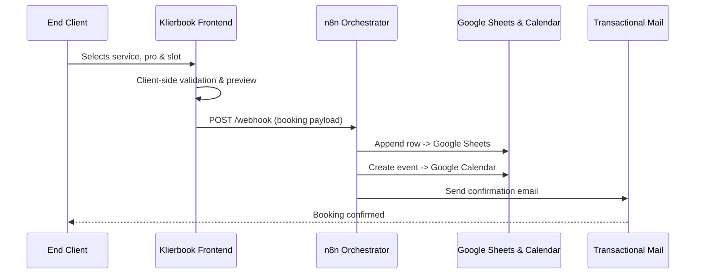

# Klierbook

[](https://github.com/SerjCallier/klierbook/actions)


**English** | [Español](README.es.md)

> **Zero-subscription booking SaaS** that turns any professional service into a 24/7 self-scheduling machine — powered by React 19, TypeScript, n8n webhook orchestration, and Google Sheets/Calendar.

---

## Why Klierbook?

Most booking tools lock small businesses into **$30–$80/month subscriptions** before they've even validated demand. Klierbook flips that model: a white-label React frontend connected to a **serverless n8n + Google Sheets backend**, delivering an enterprise-grade booking experience at **zero recurring database cost**.

**Built for:** Spas, barbershops, dental clinics, fitness studios, and service-based businesses.

---

## Features

| Feature | Description |
| :--- | :--- |
| **Frictionless Booking Flow** | Multi-step wizard: service → professional → date/time → confirmation. Zero page reloads. |
| **Dynamic Theming Engine** | Curated niche palettes via `useNicheTheme` (barbershops, beauty salons, clinics, gastronomy, sports). |
| **Mobile-First Conversion** | Thumb-friendly responsive layout built with Tailwind CSS. |
| **n8n Webhook Integration** | Fires booking payloads to an n8n workflow (`n8n_create_booking_workflow.json`) syncing Google Sheets, Calendar, and email confirmations. |
| **i18n Ready** | Full bilingual support (EN/ES) with `react-i18next` and `date-fns` locale formatting. |

---

## Architecture



---

## Quick Start

```bash
git clone https://github.com/SerjCallier/klierbook.git
cd klierbook

npm install
npm run dev      # Local development server at http://localhost:5173
npm run build    # TypeScript check + Vite production bundle
```

---

## License

MIT © [Sergio Callier](https://github.com/SerjCallier)
